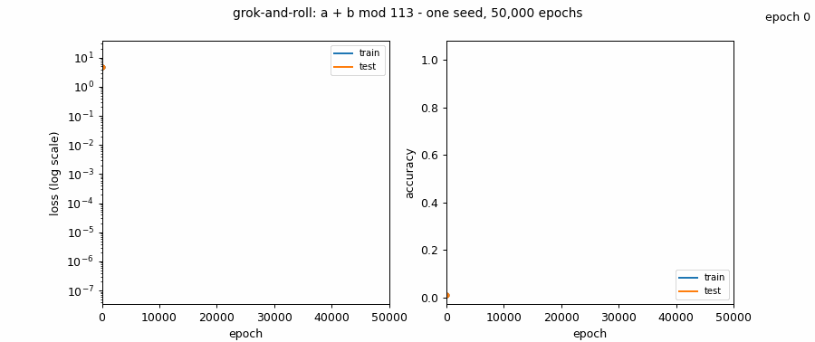
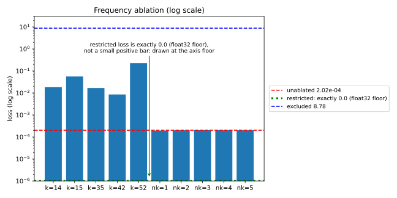

# grok-and-roll

A one-layer transformer memorizes `a + b mod 113` within 200 epochs, sits with near-chance test accuracy for 8,000+ epochs, then suddenly generalizes - the grokking phenomenon of Nanda, Chan, Lieberum, Smith & Steinhardt (ICLR 2023), reproduced from scratch and dissected with the paper's mechanistic tools.



*One seed, 50,000 epochs, drawn from `records/metrics.jsonl`; the loss panel is log-scale. The shaded band marks epochs 8,600-9,600, where test accuracy sweeps from 0.55 to 0.99 while test loss collapses.*

## How the run unfolded

### The plateau

Train accuracy hits 1.0 by epoch 200 (`records/metrics.jsonl`). Test accuracy stays below 0.31 for the next 8,000+ epochs while test loss keeps climbing to its peak, 29.96 around epoch 1,700 - the model is a lookup table that is still growing. The progress measures show what the headline numbers hide: through the whole plateau, loss restricted to the five key frequencies falls steadily, while loss through the excluded frequencies rises from 4.76 toward 8.78 (`records/progress_measures.jsonl`). A generalizing circuit is assembling underneath the memorizer.

### The turn

Between epochs 8,600 and 9,600, test accuracy sweeps from 0.55 to 0.99 (first epoch above 0.5: 8,600; above 0.99: 9,600; 1.0000 by 10,300), while test loss collapses from ~5.4 to ~0.03. That is grokking: the gap between memorizing the training set and generalizing closes in about a thousand epochs of training.

### The five frequencies

The Fourier analysis of the final model (the paper's method, independently reimplemented) finds five key frequencies, K = [14, 15, 35, 42, 52] (`records/key_freqs.json`) - the same count as the paper's analyzed model, four of the five identical to its set. The generalizing circuit is a Fourier-multiplication algorithm over these frequencies.

### The ablation test



*Log-scale loss axis. The restricted loss is exactly 0.0 - the float32 floor - so it is drawn as the green line at the axis floor, not as a small positive bar.*

Keep only the five key frequencies and the model still solves the task: restricted loss 0.0 (exactly zero in float32). Remove them and loss jumps to 8.78, worse than guessing uniformly. Ablating any single key frequency hurts (0.0085-0.228); ablating the strongest non-key frequencies barely registers (~0.00020, indistinguishable from the unablated 2.02e-04).

## Results (from records only)

- Final metrics (epoch 50,000, `records/metrics.jsonl`): train_loss 7.66e-08, test_loss 2.88e-04, train_acc 1.0000, test_acc 0.99989. Test accuracy crossed 0.99 at epoch 9,600 and reached 1.0000 by 10,300.
- Key frequencies (`records/key_freqs.json`, final snapshot, neuron-variance method): K = [14, 15, 35, 42, 52] with per-neuron support {14: 60, 15: 115, 35: 101, 42: 127, 52: 109}.
- Final-model losses (`records/ablation.jsonl`): unablated 2.02e-04; restricted 0.0; excluded 8.78. Single-frequency exclusion: key frequencies give 0.0085-0.228; the five lowest non-key frequencies (1-5) all stay at ~0.00020.
- Progress measures (`records/progress_measures.jsonl`): excluded loss rises from 4.76 (epoch 0) to 8.78 (epoch 50,000); Gini(W_E) rises 0.035 -> 0.62, Gini(W_U) 0.032 -> 0.67; sum of squared weights falls 1783 -> 973 (peaking ~3658 during memorization).
- Runtime (`records/environment.json`): 2771.72 s real, peak RSS 424427520 bytes (MPS).

> **One-seed caveat (observation only):** this run is one seed, and it showed early test-loss spikes plus post-cleanup oscillations in Gini and weight norm. The paper's published curves average five seeds; whether those wiggles are seed noise is not established here.

## Reproduce

```bash
# Stage 0-1: scaffold, implementation, unit tests
python3 -m unittest discover -s tests -v
# Stage 2: pilots (device choice + determinism diagnostic)
/usr/bin/time -l python3 -m src.train --device cpu --epochs 300 > logs/pilot_cpu.log 2>&1
/usr/bin/time -l python3 -m src.train --device mps --epochs 300 > logs/pilot_mps.log 2>&1
# full run
/usr/bin/time -l python3 -m src.train --device mps --epochs 50000 > logs/run.log 2>&1
# Stage 3-4: analysis and figures
python3 -m src.analyze --device cpu
python3 -m src.plot_figures
```

## Scope compared with the paper

- Mainline modular-addition study only: training, logit-space Fourier analysis, progress measures, and frequency ablation. (OURS: nothing else was run.)
- One seed (OURS) versus the paper's five-seed Figure 2.
- Neuron/activation-space interventions of Section 4.4 are excluded (OURS).
- Non-modular tasks, no-weight-decay/slingshot analysis, and robustness sweeps are excluded (OURS).
- Device: MPS (OURS; see environment.json) versus the authors' cuda.
- wandb logging replaced with local JSONL records (OURS); metrics cadence densified to every 100 epochs (OURS) from the authors' every-1000.

## Settings

<details>
<summary>Full settings table (verified / OURS)</summary>

| Setting | Value | Source |
|---|---|---|
| p, d_vocab, n_ctx | 113, 114 ("=" token 113), 3 | verified (paper / authors' code) |
| Architecture | 1-layer ReLU transformer, d_model 128, 4 heads (d_head 32), d_mlp 512, no LayerNorm, untied embed/unembed, learned positional embeddings | verified |
| Init scales | W_E randn(128,114)/sqrt(128); W_pos randn(3,128)/sqrt(128); W_K/Q/V randn(4,32,128)/sqrt(128); W_O randn(128,128)/sqrt(128); W_in randn(512,128)/sqrt(128) with b_in=0; W_out randn(128,512)/sqrt(128) with b_out=0; W_U randn(128,114)/sqrt(114) | verified (authors' constructors) |
| Attention | per-head q.k scores, causal mask via -1e10 upper-triangle penalty, 1/sqrt(d_head) scaling after masking, softmax, concat + W_O; residuals around attention and MLP; logits read at the "=" position | verified |
| Optimizer | AdamW on ALL parameters, lr 1e-3, betas (0.9, 0.98), weight_decay 1.0, eps 1e-8 (PyTorch default; authors' code does not set it) | verified |
| Warmup | LambdaLR, multiplier min((step+1)/10, 1) over the first 10 steps, one optimizer step per epoch (full batch) | verified (index convention OURS) |
| Training loss | cross-entropy over all 114 logits, full-batch mean, log_softmax in float32 | verified |
| Reported loss / accuracy | "=" logit column dropped, 113 kept logits; accuracy = argmax over the 113 kept logits | verified for loss; accuracy convention OURS |
| Epochs | 50000 | verified |
| Split | all 113^2 pairs shuffled with python random.seed(0); first 30% train | verified |
| Init seed | torch.manual_seed(0) before construction | OURS |
| Device | MPS (chosen by 300-epoch pilot: CPU 15.51 ep/s, MPS 15.72 ep/s) | OURS |
| Snapshot schedule | state_dict only, at epochs 0..1000 step 100 and every 1000 from 2000 to 50000 (60 snapshots) | OURS |
| Metrics cadence | every 100 epochs | OURS |
| Gini | 1D Fourier transform over the token axis of W_E and W_U (113 token rows, "=" row excluded), L2 norm over the model dimension per real-basis component, DC included, standard Gini formula G = sum_i (2i - n - 1) x_i / (n * sum_i x_i) | OURS where the paper is silent (DC inclusion, real-basis component count) |
| Logging | local records/*.jsonl; snapshots/ untracked | OURS |
| Seed count | 1 | OURS |

</details>

## Sources

- Paper: https://arxiv.org/abs/2301.05217 (ICLR 2023) - specifications for the architecture, optimizer, split, progress measures, and ablation protocol were taken from its text.
- Author walkthrough: https://www.neelnanda.io/grokking-paper - used as corroboration of the paper's narrative and phase description.
- Authors' code: https://github.com/mechanistic-interpretability-grokking/progress-measures-paper - consulted as read-only provenance for configuration details. It carries NO LICENSE file, so no code or checkpoints were copied or downloaded; everything here is independently reimplemented from the written specifications.

## Honest limits

- Single seed: onset epochs and key frequencies could differ across seeds; the paper reports five.
- MPS numerics differ from cuda and from CPU; a 300-epoch CPU-vs-MPS fidelity comparison and a run-to-run hash check (mismatch - MPS nondeterminism) are recorded in records/environment.json.
- No direct comparison against the authors' code was performed (no license; independent reimplementation).
- Choices the paper is silent on (init seed, device, snapshot schedule, metrics cadence, accuracy convention, Gini DC/real-basis handling, logging) are labeled OURS above; the most likely-effect-bearing of these is the device (numerics only) and the init seed (which frequencies get selected could shift).
- Figures were validated programmatically at run time (XML parse, viewBox, element count) and pixel-checked during the documentation pass: the animation, its sampled frames, and the log-scale ablation figure were rendered to PNG and inspected; see the run report's VISUAL QA line.
